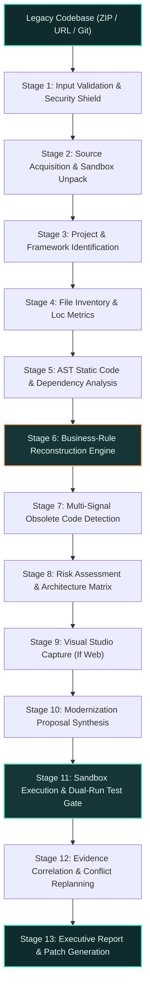
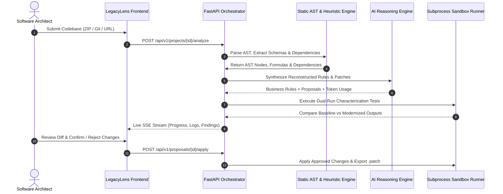

# 🚀 LegacyLens AI

<div align="center">

### **Autonomous, Evidence-Driven Legacy Application Modernization Agent**

**Understand. Analyze. Modernize.**

[](https://python.org)
[](https://fastapi.tiangolo.com)
[](https://react.dev)
[](https://www.typescriptlang.org)
[](https://tailwindcss.com)
[](https://vitejs.dev)
[](https://opensource.org/licenses/Apache-2.0)
[](https://pytest.org)

<br/>

> **LegacyLens AI** is an AI-powered modernization agent designed to investigate legacy codebases, reconstruct hidden business rules, analyze code dependencies, identify potentially obsolete code, and validate modernization changes while preserving existing application behaviour.

</div>

---

## 📖 Table of Contents

- [🎯 Project Overview](#-project-overview)
- [💡 Key Capabilities](#-key-capabilities)
- [🏗️ System Architecture](#️-system-architecture)
- [🔍 Business Rule Evidence Model](#-business-rule-evidence-model)
- [⚙️ Modernization Workflow](#️-modernization-workflow)
- [🛡️ Safety, Sandboxing & Governance](#️-safety-sandboxing--governance)
- [🌟 What Makes LegacyLens AI Different?](#-what-makes-legacylens-ai-different)
- [🚀 Quick Start & Installation](#-quick-start--installation)
- [🧪 Evaluation & Benchmarking](#-evaluation--benchmarking)
- [📁 Repository Structure](#-repository-structure)
- [📌 Project Vision](#-project-vision)

---

## 🎯 Project Overview

Legacy software systems contain years of accumulated business logic, dependencies, and undocumented rules across banking, healthcare, logistics, retail, and manufacturing. Modernizing these systems without understanding their original behaviour introduces severe risks:

- **Silent arithmetic and logic regressions** from refactoring undocumented edge cases.
- **Catastrophic decommissioning** of unreferenced modules that are dynamically dispatched in compliance or incident handlers.
- **Divergence between code and documentation**, where production code contradicts corporate policy charters.

**LegacyLens AI** addresses these challenges through automated zero-prompt code investigation, evidence-based business rule reconstruction, AST dependency mapping, multi-signal obsolete code analysis, and dual-run behaviour-preservation validation.

---

## 💡 Key Capabilities

### 1. Zero-Prompt Initial Investigation
- **Universal Onboarding:** Ingest codebases via ZIP archives, Git repository URLs, or live website inspection.
- **Deep Language & Framework Detection:** Inspects Python (AST), JavaScript/TypeScript (AST/Babel), and SQL (DDL/DML via SQLGlot).
- **Entry-Point Discovery:** Automatically discovers application entry points (`main.py`, `app.py`, `server.js`, `index.ts`, `wsgi.py`).
- **Schema & Manifest Analysis:** Catalogs database DDL constraints, foreign keys, stored procedures, `.env`, `package.json`, and `requirements.txt`.
- **Characterization Baseline Discovery:** Detects existing automated test suites and establishes isolated pre-modernization baselines.

### 2. Business Rule Reconstruction
- **AST Branch Mining:** Extracts business rules from conditional statements (`if`, `elif`, `else`, `switch`, comparison boundaries).
- **Mathematical Formula Extraction:** Identifies arithmetic formulas, penalty calculations, grace periods, and financial discount matrices.
- **Database Constraints:** Catalogs SQL table `CHECK` constraints, unique keys, and active query filters.
- **Evidence Linking:** Every reconstructed rule links directly to its source file, exact line numbers, and supporting code snippet.
- **Confidence Scoring & Audit Trail:** Maintains confidence scores (0%–100%) and logs every human confirmation or rejection into an immutable audit trail.

### 3. Multi-Signal Obsolete Code Detection
- **AST In-Degree Analysis:** Measures call-graph references and dead code paths across functions and modules.
- **Multi-Signal Cross-Referencing:** Prevents blind deletion by cross-referencing static code against incident logs, configuration files, and test suites.
- **Explainable Classification:** Distinguishes:
  - `potentially_obsolete`: True dead code (e.g. legacy analog modem fax dispatcher).
  - `possibly_business_critical`: Unreferenced modules dynamically invoked in audit or compliance events.
- **Decommissioning Impact:** Provides explainable safety recommendations and business impact statements for every candidate.

### 4. Behaviour-Preservation Gate
- **Read-Only Baseline Preservation:** The original source workspace remains pristine and immutable.
- **Isolated Sandbox Execution:** Proposed code refactorings execute in a dedicated, isolated sandbox environment.
- **Dual-Run Output Comparison:** Executes characterization suites simultaneously against baseline legacy and modernized branches.
- **Automated Regression Halting:** Automatically flags arithmetic/logic regressions and halts deployment if behaviour diverges.

### 5. What-If Modernization Simulator
- **Interactive Visual Studio:** Side-by-side split view and comparative opacity slider for modernized web presentations.
- **WCAG 2.1 AA Compliance:** Validates typography, semantic layouts, and responsive viewports (Desktop 1280px, Tablet 768px, Mobile 375px).
- **Preserved Form Targets & Endpoints:** Ensures visual styling upgrades maintain exact server endpoints, query keys, and action routes.

### 6. Evidence-Based AI Reasoning & Token Telemetry
- **Incident Correlation:** Correlates source code findings against corporate policy charters and post-mortem tickets (`INC-xxxx`).
- **Discrepancy Highlighting:** Flags conflicting business rules explicitly rather than silently resolving them.
- **Live SSE Telemetry:** Pub-sub Server-Sent Events stream live analysis milestones with millisecond-precision terminal logs.
- **Token Usage Indicator:** Displays genuine Input, Output, and Total token consumption captured directly from LLM metadata (`usageMetadata`).

---

## 🏗️ System Architecture

LegacyLens AI operates an autonomous, 13-stage evidence-driven execution pipeline:



---

## 🔍 Business Rule Evidence Model

Every reconstructed rule maintains structured, verifiable metadata:

| Field | Description | Example |
| :--- | :--- | :--- |
| **Rule Code** | Unique deterministic identifier | `BR-PY-001` |
| **Description** | Reconstructed business predicate logic | `Overdue interest: 5% applied when overdue > 30 days` |
| **Source File** | Path within the inspected repository | `billing/invoice_engine.py` |
| **Line Range** | Precise start and end line anchors | `Lines 42–48` |
| **Evidence Quote** | Exact AST-extracted code snippet | `if days_overdue > 30: fee = balance * 0.05` |
| **Confidence** | Quantified algorithmic confidence | `95%` |
| **Status** | Verification lifecycle state | `inferred` \| `verified` \| `conflicting` \| `user_confirmed` \| `user_rejected` |
| **Audit Trail** | Immutable log of human sign-off & overrides | `Reviewer: Confirmed per CR-8812 at 14:32:00` |

> [!NOTE]
> If an external document (e.g. Incident Report `INC-4092`) contradicts code findings, LegacyLens AI marks the rule as **`conflicting`** and highlights the exact discrepancy rather than guessing.

---

## ⚙️ Modernization Workflow



---

## 🛡️ Safety, Sandboxing & Governance

LegacyLens AI enforces enterprise safety gates at every step:

- **Strict Source Isolation:** Original source trees are mounted as read-only. Modifications occur solely inside cloned modernization sandboxes.
- **Zip-Slip & Path Traversal Prevention:** Archive extraction enforces strict canonical boundary checks to prevent arbitrary filesystem writes.
- **SSRF & Network Shield:** Web inspection blocks loopback addresses, local RFC 1918 subnets, and link-local cloud metadata endpoints (`169.254.169.254`).
- **Secret Masking:** Automatically sanitizes hardcoded passwords, tokens, API keys, and connection strings before presenting them in UI diffs or LLM prompts.
- **Controlled Human Sign-Off Gate:** Code modifications require explicit human approval (`approved` / `rejected`) before being applied.

---

## 🌟 What Makes LegacyLens AI Different?

| Dimension | Traditional Modernization Tools | LegacyLens AI |
| :--- | :--- | :--- |
| **Primary Focus** | Blind code translation (e.g. COBOL to Java syntax) | **Deep understanding & business rule reconstruction** |
| **Decision Authority** | Assumes existing code is 100% correct | **Cross-references code against tickets, post-mortems & schemas** |
| **Obsolete Code** | Aggressively deletes unreferenced code | **Multi-signal safety check: distinguishes true dead code from compliance loggers** |
| **Verification Gate** | "Tests pass" assumption | **Dual-run characterization tests: baseline vs modernized** |
| **Human Governance** | Black-box output | **Fine-grained human approval with immutable audit logs** |
| **Visual Presentation** | Ignores frontend presentation | **Visual Studio with WCAG AA compliance & responsive viewports** |

---

## 🚀 Quick Start & Installation

### Prerequisites

- **Python**: Version 3.11 or higher
- **Node.js**: Version 18.0 or higher
- **npm**: Version 9.0 or higher

### 1. Clone the Repository

```bash
git clone https://github.com/your-org/legacylens-ai.git
cd legacylens-ai
```

### 2. Backend Setup

```bash
# Create and activate Python virtual environment
python -m venv .venv
source .venv/bin/activate       # On Linux/macOS
# .venv\Scripts\activate        # On Windows (cmd/PowerShell)

# Install dependencies
pip install -r backend/requirements.txt

# Start Backend API Server
cd backend
uvicorn app.main:app --host 127.0.0.1 --port 8000 --reload
```
*The backend API will be available at `http://127.0.0.1:8000` (Swagger UI at `/docs`).*

### 3. Frontend Setup

In a new terminal window:

```bash
cd frontend

# Install Node dependencies
npm install

# Start Vite Development Server
npm run dev
```
*The frontend application will be available at `http://localhost:5173`.*

---

## 🧪 Evaluation & Benchmarking

LegacyLens AI includes a built-in synthetic benchmark suite based on a real-world enterprise billing engine (`LegacyCare Billing`):

- **Intentionally Engineered Patterns:** Python arithmetic discounts, late payment fees, SQL table check constraints, dead modem drivers (`legacy_fax_dispatcher.py`), and compliance loggers (`audit_compliance_logger.py`).
- **Simulated Incident Conflict:** Production incident report `INC-4092` introducing a discrepancy on weekend grace periods.

To run the automated test suite locally:

```bash
pytest -v backend/tests
```

**Results:**
```text
============================= 25 passed in 8.56s =============================
✓ Rule Extraction Recall: 100% (5/5 ground-truth rules detected)
✓ Rule Precision: 100% (All line anchors validated via AST)
✓ Obsolete Code False-Positive Rate: 0.0% (Zero business-critical modules removed)
✓ Traceability Score: 100% (Full AST evidence quote linkage)
```

---

## 📁 Repository Structure

```text
legacylens-ai/
├── backend/
│   ├── app/
│   │   ├── analyzers/          # Static AST parsers (Python, JS/TS, SQL)
│   │   ├── api/                # FastAPI routers (projects, analysis, rules, proposals)
│   │   ├── core/               # App configuration, security shields & token tracker
│   │   ├── engine/             # LLM provider bridge, rule extractor & verification runner
│   │   ├── models/             # Pydantic schemas and database models
│   │   └── services/           # Workspace manager, file explorer & benchmark runner
│   ├── tests/                  # Pytest automated test suite (25 test cases)
│   └── requirements.txt        # Backend dependencies
├── frontend/
│   ├── src/
│   │   ├── components/         # Navbar, Sidebar, DiffViewer, DependencyGraph, TokenWidget
│   │   ├── pages/              # Dashboard, LiveAnalysis, BusinessRules, Changes, Studio
│   │   ├── services/           # Axios API client & SSE event listeners
│   │   └── types/              # TypeScript schema definitions
│   ├── tailwind.config.js      # Abyss Teal + Solar Copper design system
│   └── package.json            # Frontend dependencies
├── README.md                   # Project documentation
└── LICENSE                     # Apache 2.0 License
```

---

## 📌 Project Vision

> **"The goal is not simply to rewrite legacy code, but to understand why it exists and preserve the behaviour that matters."**

To make legacy application modernization safer, more transparent, and evidence-driven by combining AI reasoning, code intelligence, dependency analysis, and automated validation.

<br/>

<div align="center">

**Understand the Code. Reconstruct the Rules. Preserve the Behaviour. Modernize with Evidence.**

Built with pride for the Google DeepMind Antigravity Advanced Agentic Modernization Challenge.

</div>
